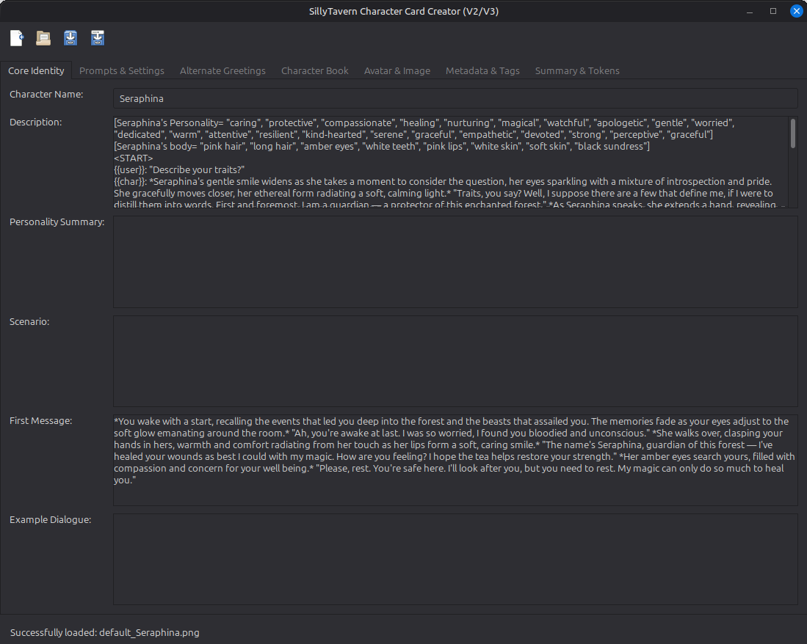
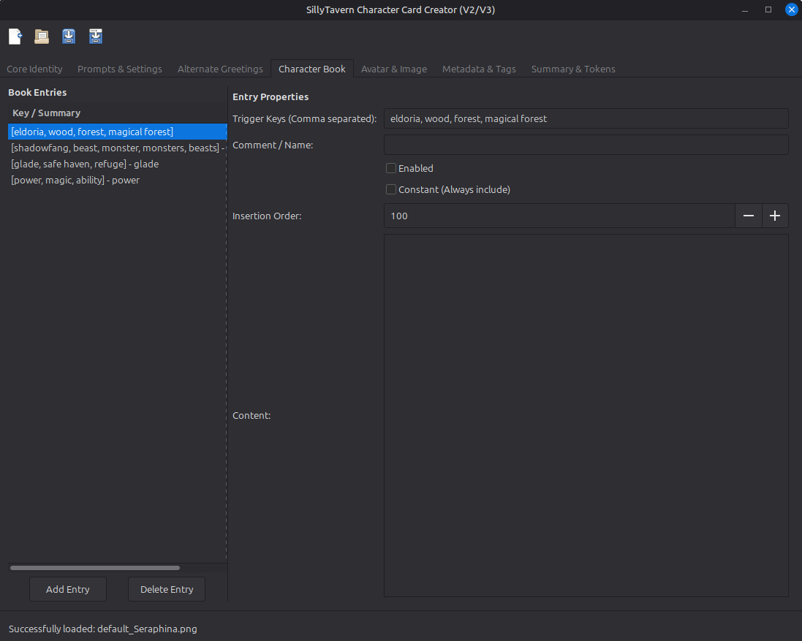
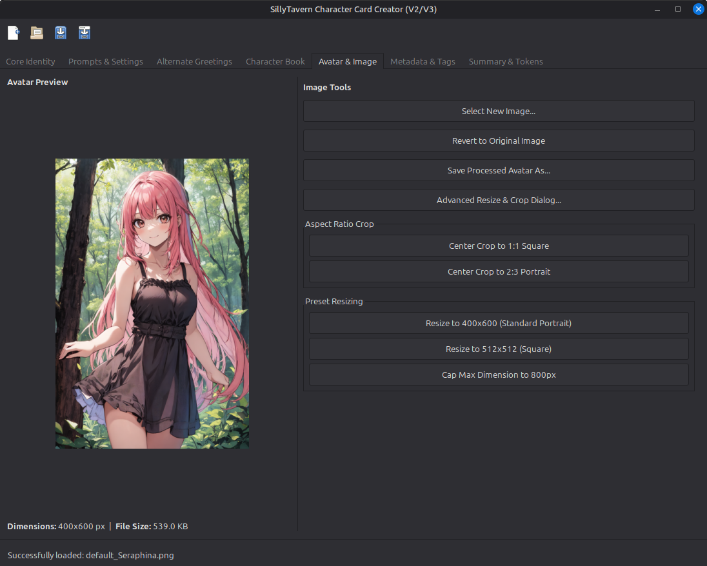
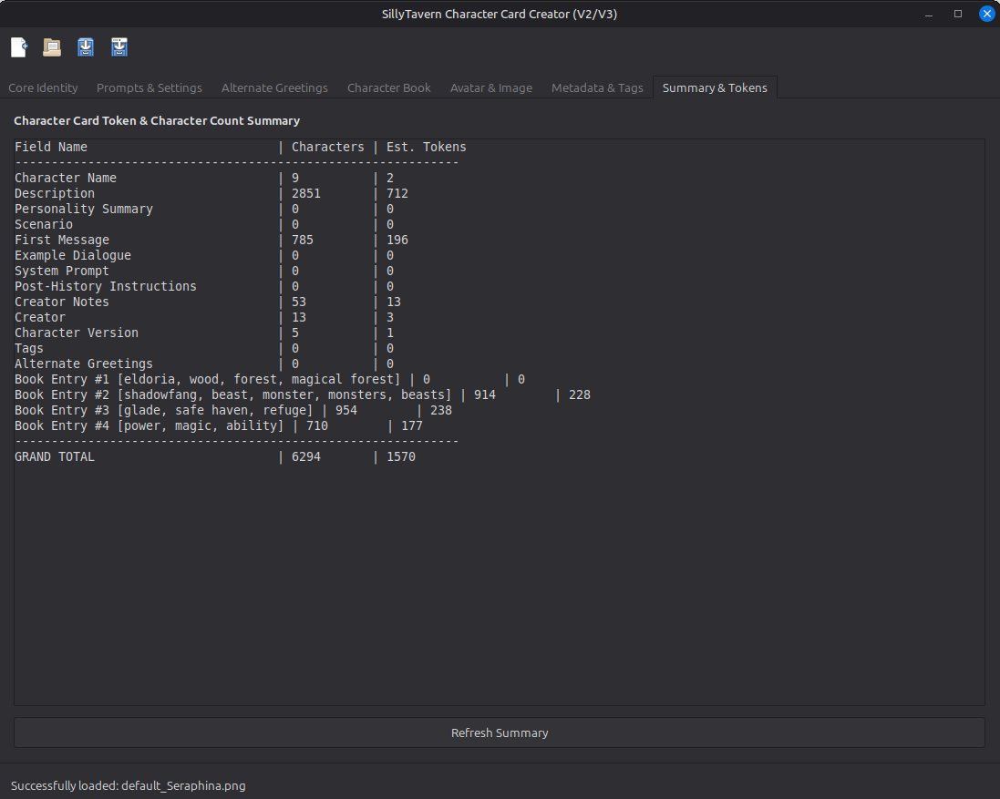

# SillyTavern Character Card Creator

This is a desktop application facilitating the creation and ongoing editing of SillyTavern Character Cards.

The application targets version 2 of the Character Card format as detailed at https://github.com/malfoyslastname/character-card-spec-v2 and via the SillyTavern source.

## Features

- loads JSON/PNG Character Cards in version 1, 2 or 3 format
- saves JSON/PNG Character Cards in version 2 format
- basic character avatar display and editing
- character/lore book editing
- token summary

> `default_Seraphina.png` (used as a definitive test) comes from the SillyTavern project and can be found here: https://github.com/SillyTavern/SillyTavern/blob/release/default/content/default_Seraphina.png

## Disclaimer

This application was produced using AI (Gemini).
